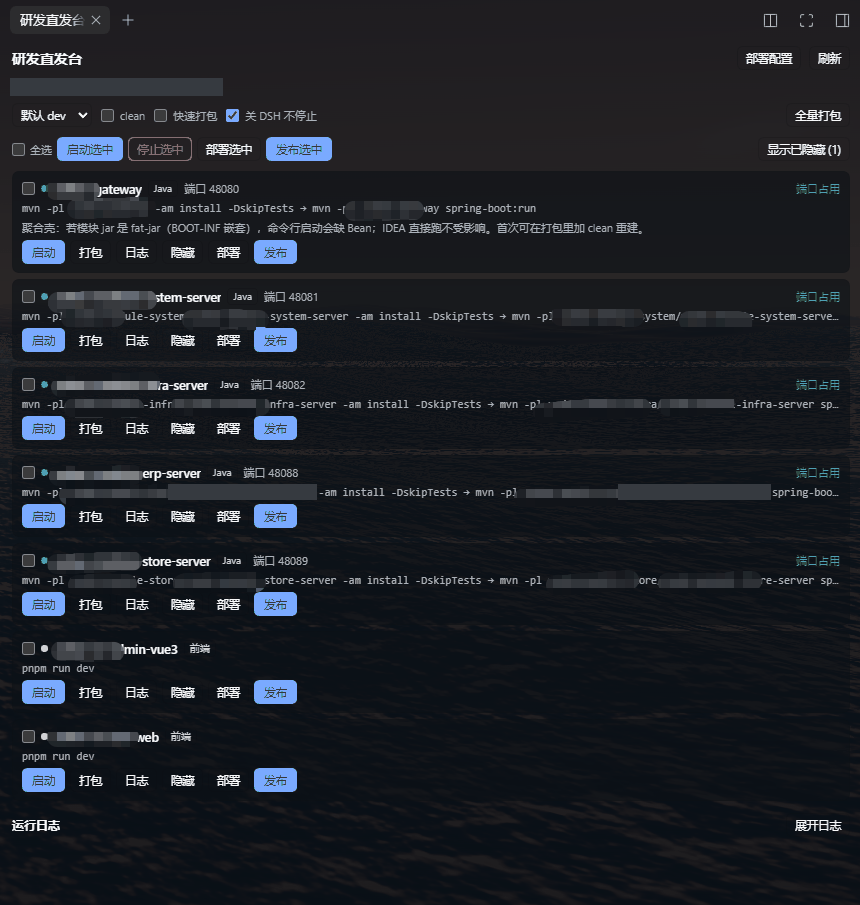

# dsh-devship（研发直发台） · 应用运行

在 DSH **右侧栏**里多出一个「应用运行」标签页，列出**当前工作区可启动的项目**，像 IDEA 的启动配置一样一键启动 / 停止 / 重启，并支持 Maven 打包、实时看日志尾部。



## 安装

```powershell
# DSH Desktop
dsh plugin --profile desktop add dsh-devship

# dsh web
dsh plugin --profile web add dsh-devship
```

装完重启 DSH，右侧栏出现「应用运行」页签。开发时也可以直接指向本地目录（改代码后重启即生效）：
`dsh plugin --profile desktop add E:\workspace\dsh-devship`。

## 面板在哪

- 右侧栏（会话右边那列）出现一个「应用运行」页签，插件激活后自动打开；关掉后可从右侧栏的「+」菜单里重新打开；
- 面板顶部显示工作区路径、Profile 选择（默认 dev / local）、clean 开关、刷新、全量打包；
- 每个项目一张卡片：勾选框、状态点、类型徽标（Java / 前端）、端口、实际会执行的命令、`启动 / 停止 / 打包 / 日志 / 清除 / 隐藏`；
- **批量操作**：卡片前的勾选框 + 顶部「全选 / 启动选中 / 停止选中」；批量启动按顺序一个个来（避免多个 Maven 同时写本地仓库），失败的会汇总提示「哪个项目 + 什么原因」；
- **一键清除**：底部「执行任务」列表右上角一次清掉所有打包 / 部署 / 发布记录；如果其中有正在跑的任务，按钮就地变成「确认清除？会中断任务」+ 是 / 否（不弹系统对话框，3 秒不点自动收回），点「是」后先中断子进程 / SSH 上传，再把条目移除（不再出现「列表里没了、进程还在后台跑」）；
- **完成自动清除**：面板上「完成自动清除」一行，打包 / 部署 / 发布各一个开关，加一个延迟（立即 / 5 / 15 / 30 / 60 秒）；勾选的任务类型跑完后自动从「执行任务」列表里移除，日志文件照常落盘保留。开关存在 `<工作区>/.dsh-devship/prefs.json`，由 Host 侧计时，面板关掉也生效；**失败的任务不会自动清除**，避免错误信息跟着条目一起消失；开了自动清除的任务在状态后面显示「N 秒后收起」倒计时；
- **隐藏服务**：每行「隐藏 / 取消隐藏」，隐藏列表持久化在 `<工作区>/.dsh-devship/prefs.json`；顶部按需出现「显示已隐藏 (n)」开关，隐藏项半透明显示；
- 端口被**外部实例**（IDEA / 终端起的）占用时，该行会标「端口占用」，点启动会先给出明确提示而不是白跑一遍 Maven；
- 标签页 `keepMounted`，切走再切回不会丢轮询状态；每 2.5s 拉一次运行状态与日志尾部。

## 能识别什么

- **Java**：根 `pom.xml` 的 `<modules>` 里、且 `src/main/java` 下存在 `*Application.java` 的模块（含 `父模块/子模块-server` 这种二级模块）。端口从 `application-dev.yaml` 的顶层 `server.port` 读取。
- **前端**：根目录或两层子目录里带 `scripts.dev` 的 `package.json`（如 `ui/*`、`web/*` 这类前端子目录），用 `pnpm dev` 启动。
- 扫描结果缓存 5 分钟（`SCAN_TTL_MS`），同一工作区的重复扫描会合并；面板右上「刷新」按钮强制重新扫描，新增模块无需重启插件。

## 启动流程（Java）

1. `mvn -pl <模块> -am -DskipTests -Dspring-boot.repackage.skip=true install`
   - `-am` 先构建上游模块，避免本地仓库里是过期快照；
   - `-Dspring-boot.repackage.skip=true` 让模块 jar 保持普通 jar（`BOOT-INF` 嵌套包会让聚合壳启动时缺 Bean）。
2. `mvn -pl <模块> spring-boot:run`（可带 `-Dspring-boot.run.profiles=<profile>`）。

两个阶段共用一份日志尾部；进入运行阶段时会清掉构建日志，只留应用输出。启动前会用 800ms 探测端口，已被占用就直接提示「可能已在运行」，不再白跑一遍 Maven。

Windows 上启动不会弹黑色控制台窗口：`.cmd` 由隐藏窗口的 `powershell -WindowStyle Hidden` 执行（DSH 自己起的子进程也是隐藏启动的），
退出码照常回传。停止时附带模式走 `handle.terminate()`（DSH 的作业对象连带整棵 powershell → cmd → mvn → java / node 一起结束），
脱离模式用 `taskkill /T /F` 结束整棵树。

日志区固定 260px 高、内部滚动，不随内容伸缩。

## 配置（可选）

工作区根目录放 `.dsh-devship.json`，可覆盖自动探测结果：

```json
{
  "maven": "D:/ProgramFiles/apache-maven-3.9.15/bin/mvn.cmd",
  "pnpm": "C:/Users/me/AppData/Roaming/npm/pnpm.cmd",
  "javaHome": "C:/Users/me/.jdks/ms-25.0.4"
}
```

不写也能用：Maven 依次找 PATH → `M2HOME/MAVEN_HOME/bin` → 常见安装目录 → IDEA 自带 Maven；
JDK 按根 pom 的 `java.version` 找匹配的版本，常见目录按平台给：Windows 是 `~/.jdks`、`C:\Program Files\Java`、Adoptium / Zulu / Corretto 等；macOS 是 `/Library/Java/JavaVirtualMachines`（含 `Contents/Home` 那一层）和 Homebrew；Linux 是 `/usr/lib/jvm` 与 sdkman（`JAVA_HOME` 版本不合适时会自动换）。

运行时产生的启动脚本放在 `<工作区>/.dsh-devship/`。

面板上的「完成自动清除」开关和隐藏服务列表存在同一个文件 `<工作区>/.dsh-devship/prefs.json`，也可以直接改它：

```json
{
  "hidden": ["ui/admin"],
  "autoClear": { "build": true, "deploy": true, "release": false, "delayMs": 15000 }
}
```

`delayMs` 只认 `0 / 5000 / 15000 / 30000 / 60000`（其它值回落到 15000）；自动清除只处理**成功**和**已停止**的收尾，失败的任务留在列表里，仍可手动清除或「一键清除」。

## 部署（把包发到测试服务器）

面板右上「部署配置」打开的是一个表单（保存在 `<工作区>/.dsh-devship/deploy.json`）：

- **测试服务器**：地址（IP/域名）、端口、用户、密码 —— 直接填你的测试机，不依赖任何预设主机
- **可选**：`dsh-ssh` 主机别名。填了就用 dsh-ssh 里存的凭据，留空则用上面的地址/密码（地址优先）
- **各服务部署目录**：每个项目一行，填远端目录（留空 = 该项目不部署，卡片上不出现「部署」按钮）

对应 JSON（想看原文时）：

```json
{
  "host": "10.0.0.9", "port": 22, "user": "root", "password": "***",
  "targets": {
    "app-server": { "remoteDir": "/data/apps/demo/server" },
    "ui/admin-web": { "remoteDir": "/data/apps/demo/web/admin" }
  }
}
```

- 产物默认：Java = `<模块>/target/<artifactId>.jar`，前端 = `dist-prod`/`dist`；可用 `artifact` 覆盖
- 部署用 ssh2 走 SFTP：目录先本地打 tar（不压缩，局域网带宽足，比 gzip 快）→ 传一个包 → 远端解包；tar 不可用时退回 8 路并发逐文件上传；单个 jar 直接 put
- **上传进度与速度**：任务卡上有进度条 —— 百分比、「已传 / 总量」、实时速度；日志里每 2 秒记一行 `↑ 42% 12.3 MB / 29.1 MB · 4.8 MB/s`，传完一定记最后一行。速度按最近 5 秒的窗口算，不是整轮平均，所以传热了之后不会显示成一个偏低的速度
- 批量：「部署选中」按顺序逐个项目部署，失败项汇总提示

实测：连一台测试机 → `mkdir -p` → 上传 → `部署完成：1 个文件` 全链路通过（当时的测试产物已清理；部署配置默认是空的，等你填自己的测试机地址）。

## 打包 / 发布 / 部署（效率相关）

**打包**
- Java：`mvn -pl <模块> -am package -DskipTests -T 1C`（多线程）；勾 clean 变 `clean package`
- 「快速打包」勾选后去掉 `-am`：只编目标模块（依赖须已 install 过），并保留 `-T 1C`
- 前端：直接 `node ./node_modules/vite/bin/vite.js build --mode prod`（不经 pnpm，避免多开可见窗口）
- 全量打包：根 reactor `mvn package -DskipTests -T 1C`

**一键发布**（卡片上的「发布」）
① 打包 → ② 部署 → ③ 重启容器 → ④ 校验，全流程写在一个任务条目里，日志带阶段编号：
```
15:22:10 ① 打包（快速，不带 -am） …
15:22:10 ① 打包完成
15:22:10 ② 部署 …
15:22:10 产物：...\target\xxx.jar
15:22:10 部署完成：1 个文件，155.88 MB
15:22:10 容器 xxx 已重启，校验状态 …
15:22:10 容器状态：Up 8 seconds
✔ 发布完成
```
批量：「发布选中」逐个发布。

**部署增强**
- 目录产物：本地 `tar`（不压缩）→ 单文件上传 → 远端解包；失败自动退回 8 路并发逐文件上传
- jar 产物：上传前 `cp x.jar x.jar.bak`（回滚用）
- fat-jar 预检：jar 尾部找不到 `BOOT-INF/` 时日志里给 ⚠ 警告（不是 Spring Boot 可执行包）
- 重启后校验：`docker ps` 查容器状态，不在运行列表就带 `docker logs --tail 20` 报错
- 批量部署：多个项目同时上传（不再串行），一条 SSH 会话可复用

## 启动模式：关 DSH 不停止（开关，默认开启）

面板上「clean / 快速打包」同一行有 **「关 DSH 不停止」** 复选框，默认勾选。

| 模式 | 启动方式 | DSH 退出后 | 日志 | 停止 |
|---|---|---|---|---|
| 勾选（默认，脱离） | 写一个 `.cmd`（输出重定向到 `logs/run-*.detached.log`），外面套一层 `.ps1` 认领 pid，再用 **WMI Win32_Process.Create** 起 `wscript.exe` 隐藏启动它 | **服务继续跑** | 读日志文件（增量） | `taskkill /PID <pid> /T /F` |
| 不勾（附带） | 走 ctx.subprocess（管道），由隐藏窗口的 powershell 执行 `.cmd` | 随 DSH 一起结束 | 管道 | handle.terminate() |

脱离模式细节：
- WMI 起的进程父进程是系统服务（WmiPrvSE），不在 DSH 的作业对象里，所以 DSH 关了也不受影响
- **全程不弹控制台窗口**：WMI 起的是没有控制台的 `wscript.exe`，它用 `WScript.Shell.Run(..., 0, False)`（窗口样式 0 = 隐藏）起 powershell，powershell 的 cmd 子进程也跟着隐藏。以前 WMI 直接起 `cmd.exe`，服务跑着的时候桌面上会一直挂着一个 cmd 黑窗口
- 要跟踪的进程是那个 powershell：它第一件事就是把自己的 PID 写进 `run-*-detached.pid`，Host 轮询这个文件认领；WSH 被策略关掉时退回直接起 powershell（`-WindowStyle Hidden`，实测同样没有窗口）
- 启动脚本只有 ASCII 内容（cmd.exe 按 OEM 代码页解析，中文会破坏批处理语法）
- 记录 pid 到 `.dsh-devship/state.json`，DSH 重启后据此接管（显示「运行中（接管）」）
- 代价：脱离模式拿不到退出码（靠 pid 判活），且 **DSH 崩溃/被强杀时进程不会被自动清理**

## 重启后接管运行状态

启动服务时会把「谁在跑」写进 `<工作区>/.dsh-devship/state.json`（项目 id / 端口 / 启动时间 / 日志文件）；
停止或进程退出时自动删除对应记录。

DSH 重启后，面板每轮 `/status` 会做一次接管：

- state.json 里有记录 **且** 那个端口仍在监听 → 建一条「接管」条目放进运行列表，
  面板显示 `运行中（接管）`，日志区还能看到重启前的日志尾部（从 `logs/run-*.log` 读）
- 端口已空 → 认为服务真的停了，清掉这条记录（面板不再显示幽灵状态）
- 接管条目点「停止」：按端口找监听进程（`netstat -ano`）→ `taskkill /PID <pid> /T /F` 整棵树结束
- IDEA / 终端里自己启的服务不会被接管（state.json 里没有记录），仍按「端口占用」提示

## 日志

- 面板日志框固定 260px 高、内部滚动，显示该任务**最近 100k 字符**（约 1500~2000 行）
- **全量日志同时落盘**：`<工作区>/.dsh-devship/logs/<任务>.log`（不截断）
  - 运行任务：`run-<项目>.log`，按阶段追加（`===== 阶段 deps =====` / `===== 阶段 run =====`）
  - 打包 `build-*.log`、部署 `deploy-*.log`、发布 `release-*.log`
  - 自动清理：保留最近 60 个 / 7 天内
- 日志框右侧两个按钮：**复制**（复制全量日志到剪贴板）、**打开文件**（资源管理器定位该 .log）
- 采集层：单任务 stdout/stderr 内存窗口 64KB + spill 4MB，轮询 2.5s；
  两次轮询间隔内输出超过 4MB 才可能丢行（正常构建达不到），落盘文件与面板取的是同一份数据，
  区别只在面板会按 100k 截头、文件不截

## 已知限制

- 只管理**本插件启动**的进程；IDEA / 终端里起的实例需要先在那边停掉（端口占用会明确提示）。
- 聚合壳模块（`xxx-server` 这种把业务模块聚成一个可运行包的）：模块 jar 若已被 repackage 成 fat-jar，命令行启动会缺 Bean；IDEA 直接跑不受影响。需要命令行跑单体时，先 `mvn -pl <聚合模块> -am clean install -DskipTests -Dspring-boot.repackage.skip=true`。
- 前端 dev 端口由 Vite 自己选（占用时自动 +1），插件不接管。

## 交互通道

Host 半用 `ctx.webServer` 注册同源 HTTP 路由（`/dsh-devship/` 下 20 条：`list` `prefs` `status` `launch` `launch-batch` `stop` `stop-batch` `build` `deploy` `deploy-batch` `deploy-config` `release` `release-batch` `log` `log-open` `forget` `clear-tasks` `hide` `version` `client-report`），
Client 半用 `fetch` 调用；进程由 `ctx.subprocess` 托管，插件卸载时会终止自己启动的子进程、撤掉待执行的自动清除定时器。

## 代码结构

Host 半按职责分文件，依赖单向（state → scan → build → deploy → routes），没有循环 import：

| 文件 | 管什么 |
| --- | --- |
| [index.js](index.js) | 装配：把各模块接起来、注册路由、退出时收尾（60 行） |
| [routes.js](routes.js) | `/dsh-devship/` 下 20 条同源路由；`PROTOCOL` 是协议版本的唯一来源 |
| [lib/state.js](lib/state.js) | 进程表 / 任务表 / 日志落盘 / pid 判活 / `state.json` / 自动清除 |
| [lib/scan.js](lib/scan.js) | 工作区发现、`root` 白名单、项目扫描、mvn·pnpm·JDK 定位 |
| [lib/build.js](lib/build.js) | 启动脚本生成、启动 / 停止、打包、一键清除 |
| [lib/deploy.js](lib/deploy.js) | SSH 会话、SFTP 上传（带进度）、部署、发布 |
| [lib/progress.js](lib/progress.js) | 上传进度与速度：纯计算、不碰网络、可单测 |
| [lib/net.js](lib/net.js) · [lib/fs-scan.js](lib/fs-scan.js) · [lib/prefs.js](lib/prefs.js) · [lib/log.js](lib/log.js) · [lib/util.js](lib/util.js) · [lib/auto-clear.js](lib/auto-clear.js) | 端口探测 / 目录遍历 / 配置读写 / Host 日志 / 小工具 / 任务类别判定 |
| [client.js](client.js) | 面板界面（React `createElement`，没有构建步骤） |

界面文案在 [client.js](client.js) 里的 `DICT`（中英两份，用 `ctx.locale.register` 注册）；`locale/*.json` 只放插件自身的标题和描述，不是界面文案的来源。

改路由路径或响应结构时：`routes.js` 的 `PROTOCOL` 加 1，`test/routes.test.mjs` 里的路径清单断言会拦住没同步改 client.js 的改动。

## 安全边界

- **`root` 走白名单**：面板请求带的 `root` 只接受「DSH 认得的工作区」——`workspaceRegistry` 里的路径、会话表头的 `cwd`、沙箱策略的 `workspaceRoot`、`process.cwd()`，以及 `prefs.json` 里 `extraRoots` 显式列出的目录。
  名单外的 `root`（包括相对路径、空串、别处的绝对路径）一律回落到当前工作区：不报错，但也不会去读写那个目录。
- **逃生口 `extraRoots`**：确实要管别处的目录，就往 `<工作区>/.dsh-devship/prefs.json` 里加：

  ```json
  { "extraRoots": ["E:/other/project"] }
  ```

  Host 侧最多缓存 5 秒，面板里保存偏好会立刻让缓存失效。Windows 下比较时忽略大小写和尾部分隔符。
- **部署密码只留在 Host**：`deploy.json` 里的 `password` 不再回传浏览器，面板只看到 `hasPassword`（存没存过）。
  保存时密码留空 = 保持已存值；要删干净点「清除已存密码」。`restartCommand` 同样「留空保持、显式清除」。
- **密码仍是明文**：`deploy.json` 里存的就是明文，比 dsh-ssh 的密钥方式弱一档。测试机优先用 dsh-ssh 的 alias + 密钥，`password` 只当兜底；机器被别人用过就把 `deploy.json` 删掉。
- **远端命令里的名字都加引号**：容器名进 `docker restart` / `docker ps --filter` / `docker logs` 前一律单引号包住，带空格、`$`、`;` 也只会是一个容器名，不会变成另一条命令。

## 踩坑记录：本地插件必须导出 `./package.json`

DSH 组装前端模块图时会 `require.resolve('<包名>/package.json')` 定位包清单。
`package.json` 的 `exports` 一旦是白名单形式，**没有 `"./package.json": "./package.json"` 这一项就会抛
`ERR_PACKAGE_PATH_NOT_EXPORTED`，client-modules 捕获后把整个包静默跳过**——
表现为：Host 半一切正常（HTTP 路由都能用），但插件在界面上完全不出现，也没有任何报错。

所以 `exports` 里必须保留：

```json
"./package.json": "./package.json"
```

另外几个相关经验：

- 客户端模块清单是在 **Host 启动时**组装进 `window.__DSH_BOOT__` 的，改完 `client.js` 必须**重启 DSH**（不是刷新页面）才会加载；刷新只对已进图的 bundle 生效。
- 排查时可以 `GET /dsh-devship/client-report`（客户端 apply 时自报 `apply-start` / `apply-ok` / `apply-error` / `open-ok` / `open-failed`）确认客户端半到底跑没跑。
- **不要注册 `sidebar.right.tab.guide.entry`**：那个槽是「自定义整张卡片」，注册后会把 owner 的标准卡片（图标+标题+描述+点击打开）整个替换掉，表现是「+」列表里只剩一个点不动的图标。想要图标就写在 tab 类型里：`guide: [{ id, order, title, description, icon }]`。
- 自动打开右栏页签要两步：`ctx.sidebarRight.openTab(kind)`（会话还没挂到右栏时会抛，需要定时重试）+ `if (!isExpanded()) ctx.sidebarRight.toggleExpanded()`（只开页签不会自动展开右栏）。
- 右侧栏开关快捷键是 **Ctrl+Alt+B**（`sidebar.right.toggle`），收起状态下整条页签栏都不渲染。

## 实测记录（2026-10-19，本机）

- `/dsh-devship/list`：在一个 Maven 多模块工作区（根 pom + 二级 `xxx-server` 模块 + 两个 Vite 前端）里识别出 8 个项目，端口全部从各模块的 `application-dev.yaml` 读到。
- `/dsh-devship/version` 诊断：`required java=25`，选中 `~/.jdks` 里的 JDK 25（`JAVA_HOME` 指的是 17 时也能自动换）；`mvn` 命中本机 Maven 安装目录里的 `mvn.cmd`（PATH 里没有 mvn）。
- `/dsh-devship/launch` + `/status` + `/stop`（一个 Vite 前端）：`pnpm dev` → Vite ready（自动选端口）→ 停止后进程退出、端口释放。
- `/dsh-devship/build`（二级公共模块）：`BUILD SUCCESS`，exit 0，日志尾部实时回传。
- Java 启动链路（一个后端服务模块）：`install` 全绿（JDK 25 编译），`spring-boot:run` 起 JVM 到 Web 容器，端口被占时给出明确提示。
- 客户端半（最终版）：`client-report` 收到 `apply-start` → `apply-ok` → `open-ok (attempt 3)`，即启动瞬间两次因会话未挂载失败、第三次成功并自动展开右栏；Inspect 确认 `sidebar.right.pane.tab` 的 occupants 含 `dsh-devship.panel`。用户确认面板已出现在右侧栏。

